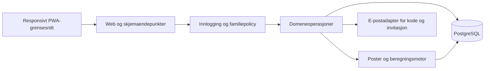
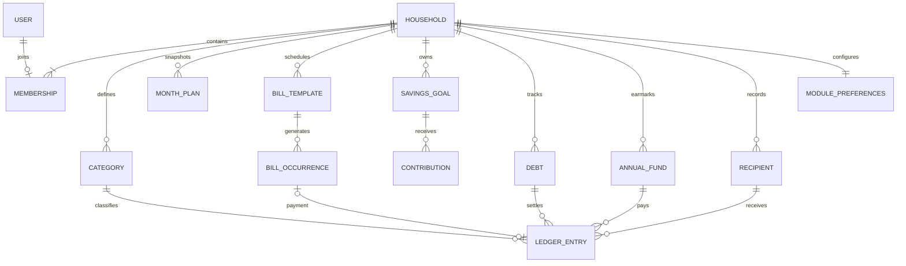

# Architecture Spine — Familieblikk

Forslag til gjennomgang; ingen appkode eller teknisk installasjon er godkjent gjennom dette dokumentet. Produktkravene er vedtatt; tekniske regler nedenfor er foreslått, med mindre merket ADOPTED.

## Design Paradigm

### Hosting constraint confirmed by Robel — 2026-10-20

Target: Robel's Synology Container Manager. Package the app and PostgreSQL as one Compose project with separate services. Local development uses a project .venv; NAS runtime uses container isolation. Application dependencies must never be installed globally. Database data must persist outside replaceable containers. Secrets are supplied at runtime and excluded from images and Git. The real workbook/import staging is excluded from the Docker build context; a narrowly scoped read-only mount is used for the authorized owner-bound import, never a public/static directory. Validate restart persistence and a database backup/restore before declaring the family's data durable. Database ports remain local to the host. NAS model/CPU, DSM and Container Manager version, storage path, HTTPS routing and SMTP are unresolved deployment inputs. No NAS connection or deployment has occurred.

**Brukerbestilt hostingendring 2026-10-21:** Standard Compose bruker host-nettverk for app, migrering og PostgreSQL. Gunicorn lytter på fast port 6451 uten portmapping. PostgreSQL bindes bare til 127.0.0.1 på separat port 6452 (POSTGRES_PORT kan tilpasses), med eksplisitt SCRAM på TCP og en skrivebeskyttet hba-konfigurasjon. Appen får fortsatt bare den begrensede approllen; eierrollen brukes av migrering. Eksisterende navngitte datavolum, hemmelighetsgrenser og privat importmontering bevares. Dette erstatter tidligere forslag om interne Compose-bridge-nettverk i AD-11 for hosting. Lokal Docker-Linux-hosttest er separat fra faktisk NAS-utrulling; Windows-tilgang via Docker Desktop krever aktivert host-støtte.

Synology supports multi-container Compose projects: https://kb.synology.com/en-global/DSM/help/ContainerManager/docker_project . Deployment files will be validated against the actual NAS version before use.

Lagvis modulær monolitt: én webapplikasjon eier innlogging, familietilgang og budsjettregler. Servergenerert HTML/CSS og små JavaScript-moduler gir appfølelse. Serveren er autoritativ for alle beløp og tilgangsavgjørelser. Ingen bank- eller betalingsintegrasjon.

## Invariants & Rules

### AD-1 — Én familie per bruker og adskilte data [ADOPTED]

- **Binds:** Alle moduler og alle lese-/skriveoperasjoner.
- **Prevents:** Tilgang til en annen families data ved bytte av ID eller hurtigbuffer.
- **Rule:** Aktivt medlemskap er unikt per bruker. Hver familieeid rad har household_id. Serveren utleder familie fra gjeldende medlemskap, aldri fra klientens familie-ID alene. Oppslag, relasjoner og aggregater filtreres på samme familie. Fremmede ID-er gir ingen data. Familie-ID inngår i eventuelle hurtigbuffernøkler. Databasebegrensninger eller validerte sammensatte nøkler avviser koblinger mellom familier. Ingen direkte databaseadgang fra nettleseren. Den siste administratoren kan ikke fjernes før en annen er utpekt [ASSUMPTION].

### AD-2 — Identitet og rettigheter [ADOPTED]

- **Binds:** Poster, inntekter, regninger, spareinnskudd, invitasjoner og innstillinger.
- **Prevents:** At skjulte knapper er eneste tilgangskontroll eller at et medlem endrer eier for å omgå regler.
- **Rule:** Alle medlemmer leser familieposter. Medlem oppretter i eget navn og endrer/sletter egne; administrator endrer/sletter alle og styrer medlemskap, kategorier og grenser. Serveren fastsetter created_by; den endres aldri. Registrering av hvem inntekten tilhører er separat fra oppretter. Rollen kontrolleres på nytt ved hver operasjon. Versjonsfelt gir konfliktmelding ved samtidige endringer; ingen stille overskriving. Audit viser actor, tidspunkt, operasjon og endrede felt, uten kode eller sesjonshemmeligheter. Systemopprettede regninger eies av administrator; ethvert medlem kan markere en ubetalt regning betalt i eget navn [ASSUMPTION]. Angring krever eier av betalingspost eller administrator.

### AD-3 — Innlogging og invitasjon

- **Binds:** Identity-modulen og e-postadapteren.
- **Prevents:** Gjenbruk av engangskoder, invitasjonskapring og familiemedlemskap i flere familier.
- **Rule:** Seks sifre, utløp etter 10 minutter, maks fem forsøk per kode, sendepause 60 sekunder og serverbasert begrensning per adresse/IP [ASSUMPTION]. Lagre kun nøkkelbeskyttet hash av koden. Ny kode ugyldiggjør den forrige. Bruk generisk sendesvar; koder er engangs og verifiseres atomisk. Bruk Django database-backed sessions i PostgreSQL, med ugjennomsiktig sesjons-ID i HttpOnly/Secure/SameSite-cookie, CSRF på mutasjoner og rotering av sesjons-ID etter kodeverifisering. Utlogging ugyldiggjør sesjonen på serveren og sletter cookien; gjenbruk av kopiert gammel cookie gir ingen tilgang. Ikke bruk signed-cookie sessions for privat familieøkonomi. Invitasjon har tilfeldig, hashet token, mottakeradresse, familie, rolle og 7 dagers utløp [ASSUMPTION]; krever verifisert samsvarende adresse og fortsatt gyldig medlemskap hos inviterende administrator. Godta én gang i transaksjon; unique user membership hindrer dobbelt opptak. Eksisterende familiemedlem får tydelig avslag, ikke automatisk flytting. Lokal e-postutvikling bruker konsoll; produksjonsleverandør avklares før utsendelse.

### AD-4 — Penger og måneder [ADOPTED]

- **Binds:** Ledger, budget, bills, savings og dashboard.
- **Prevents:** Avrundingsavvik, ulik månedstolkning og dobbeltførte inntekter.
- **Rule:** Autoritative NOK-beløp er heltall i øre. UI bruker nb-NO. Beløp oppgis positive; regnskapsklasse og retning bestemmer fortegn. Refusjon er en koblet reversering med faktisk mottaksdato; netto refusjoner kan ikke overstige opprinnelig betalt beløp uten særskilt korreksjon. Forventet inntekt gir ingen tilgjengelige penger; markering mottatt aktiverer samme inntektspost, aldri en ekstra kopi. Effektiv dato er kalenderdato i Europe/Oslo; registrert/endret-tid er UTC. Budsjettgrenser, gjeldsplan, årsavsetning og spareplan lagres som månedsversjoner. Historisk retting gjelder valgt effektiv måned og viser hvem som endret. Fremtidsdaterte faktiske poster avvises; forventet inntekt og regninger kan være fremtidige [ASSUMPTION]. Opprinnelig valuta/kurs lagres separat etter AD-13.

### AD-5 — Én beregningsmotor

Dette avsnittets enkle formel og historiske eksempel gjelder kun kjerneprojeksjonen uten valgfrie moduler og uten spareuttak. AD-10 er autoritativ for utvidet disponering og kontantresultat, også i historikk; den overstyrer enklere definisjoner her ved konflikt.

- **Binds:** Alle KPI-er, historikk, skjermbilder og tester.
- **Prevents:** At et kort, en graf og en detaljvisning beregner forskjellige beløp.
- **Rule:** Foreslått månedsformel: A = I − E − B − S. I er mottatt inntekt med effektiv dato i måneden; E er betalte utgifter i måneden; B er ubetalte regningsforekomster med forfall senest månedsslutt, inkludert gamle forfalte. S = sum per sparemål av max(månedens plan, månedens faktiske innskudd), også for mål med innskudd uten plan. Alle beløp i øre. Mål overfinansiert med 500 kr gir ikke mindre reservasjon for andre mål. Dette er en disponeringsindikator og ingen bankbeholdning. A vises også når negativt. Dagsbeløp er A delt på kalenderdager igjen inklusive i dag, avrundet ned til hele øre; ikke vis dagsbeløp for historiske/fremtidige måneder. Kategorigrense reserverer ikke penger en gang til. Betalte regninger inngår i kategoriforbruk. Forventet inntekt, ubetalte regninger og sparing er egne serier; aldri vis sparing som vanlig forbruk.

Historikk viser kontantresultat I − E − faktiske innskudd og budsjettindikator A separat. B for historisk måned er en rekonstruksjon av hva som var ubetalt ved månedsslutt, basert på effektiv betalingsdato; senere betaling endrer ikke et allerede historisk forfall til betalt i fortiden. Gamle overskudd inngår aldri i ny måneds A. Forslagene krever menneskelig aksept av designkandidaten.

### AD-6 — Regninger uten dobbeltføring

For utvidet omfang gjelder betalingsdispatch i AD-10: «utgift» i denne kjerneregelen betyr ordinær post bare når forpliktelsens regnskapsklasse er ordinær. Gjelds- og årsutgiftsforekomster lager én gjelds-/fondspost i stedet, aldri ordinær E-post i tillegg.

- **Binds:** Bills, ledger og alle betalingsknapper.
- **Prevents:** At dobbeltklikk eller to familiemedlemmer betaler samme forekomst to ganger i appen.
- **Rule:** Skill mal og forekomst. Unique(template_id, due_date) gjør generering idempotent. Generer på familielesing/kommando for valgt måned, så korrekthet krever ikke en nattjobb. Samtidig generering bruker unique constraint. Betaling låser forekomsten og oppretter nøyaktig én koblet utgift i samme transaksjon, med unik occurrence_id og idempotency_key. Samme forespørsel returnerer eksisterende resultat. Forekomsten blir paid og reservasjonen bortfaller. Angring/sletting av koblet utgift åpner forekomsten igjen atomisk; vanlig postredigering kan ikke bryte koblingen. Redigering av mal påvirker framtidige forekomster; historiske forekomster beholder beløp og kategori. Forfall den 29.–31. flyttes til siste dag i kortere måneder [ASSUMPTION]. Betaling registrerer status i budsjettet; appen flytter ingen penger.

### AD-7 — Sparemål og månedsskifte

- **Binds:** Savings, budget og dashboard.
- **Prevents:** Automatisk fiktiv sparing, dobbel reservasjon og tap av historikk.
- **Rule:** Plan er reservasjon, ikke faktisk innskudd. Faktisk fremdrift = sum innskudd på målet. Plan og ekstra innskudd følger samme beregningsregel AD-5. Målbeløp kan overskrides; vis faktisk sum og begrens bare den grafiske fremdriftslinjen til 100 %. Ny måned kopierer grenser og aktive spareplaner én gang fra sist tilgjengelige måned; poster og mottatt inntekt kopieres ikke. Behold målprogresjon og ubetalte regninger. Arkivering bevarer historikk og inneværende månedsplan; nye månedsplaner opphører fra neste måned [ASSUMPTION].

### AD-8 — PWA og synlighet [ADOPTED]

- **Binds:** Grensesnitt, serverresponser og service worker.
- **Prevents:** Gamle private familieopplysninger fra hurtigbuffer eller synkronisering etter utlogging.
- **Rule:** V1 krever nett for mutasjoner. Ingen lokal kø eller automatisk gjeninnsending. Service worker mellomlagrer bare offentlige versjonerte appressurser og en generisk offline-side. Auth-, HTML-, API- og familiesvar har private/no-store og caches aldri av service worker. Utlogging rydder klienttilstand og private DOM-data. Dashboard viser sist oppdatert og manuell oppdatering; revalider ved fokusering/navigasjon og etter lagring. Ingen sanntidsgaranti; samtidige endringer avvises med konflikttekst og bevarer brukerens felt. Webappmanifest, ikoner, safe-area og standalone-visning spesifiseres ved implementasjon. iOS-installasjon får manuell veiledning; ikke lov identisk installasjonsdialog i alle nettlesere.

Foreslått tilgang til redigering av måldefinisjoner, gjeldsoppsett, årsutgiftsoppsett og modulvalg er administrator. Alle medlemmer kan registrere egne innskudd, uttak, betalinger, overføringer og refusjoner; egne poster kan korrigeres/slettes og administrator kan gjøre dette for alle. Tilgangskontroll i AD-1–2 gjelder også modulene.

### AD-9 — Drift, miljø og bevis

- **Binds:** Implementasjonsplan, testmiljø og framtidig publisering.
- **Prevents:** At en pen prototype forveksles med verifisert flerfamilieprodukt.
- **Rule:** Separate lokale/test/produksjonsdata og hemmeligheter. Foreslå Docker-basert webprosess og PostgreSQL med private nettverk; vert, domene, HTTPS-terminering, SMTP og kostnader velges før publisering. DB-eier/migrasjonsrolle skilles fra approlle. Ingen hemmeligheter i repo eller logger. Før lansering: tester for familieisolasjon, rolleomgåelse, kodegjenbruk, samtidighet, øreavrunding, historisk betaling og månedsskifte; gjenoppretting av sikkerhetskopi demonstreres. Mål for gjenoppretting og oppbevaring må vedtas før ekte familiedata tas imot. Planlegg manuell vurdering av personvern, kontosletting og behandling av delte historiske poster før offentlig registrering; ikke lov juridisk etterlevelse fra dette dokumentet. GitHub, beskyttede main/develop og feature-PR-er settes opp etter separat autorisasjon; ingen commit/push her.

### AD-10 — Valgfrie moduler og én regnskapseffekt [ADOPTED: valgfritt omfang]

- **Binds:** Gjeld, årsutgifter, utland, årsoversikt, sparing og alle postendringer.
- **Prevents:** Skjuling som frigjør bundne penger eller dobbelt fratrekk mellom moduler.
- **Rule:** Brukeren godkjente 2026-10-20 at Excel-funksjonene tas inn, valgfritt per familie. Ny familie starter med kjernen; gjeld/årsutgifter/utland kan aktiveres uten fiktive standardforpliktelser. Årsoversikt er en presentasjon av eksisterende poster. Hver post har én regnskapsklasse: mottatt inntekt, ordinær utgift, utland, gjeldsbetaling, spareinnskudd/-uttak eller årsutgiftsbetaling. Refusjon arver opprinnelig klasse. Koblet regningsforekomst peker på samme post, ingen ekstra utgift. Vanlige utgifter og utland går i E. Ordinære ubetalte regninger går i B. Gjeld og årsutgift har egne reserver, aldri også i E/B. En modul med poster/åpne forpliktelser kan bare skjules/arkiveres; beregningen og historikken består. Endelig avslutning krever null åpne forpliktelser og eksplisitt bekreftelse. Modulen kan ikke brukes til å omgå tilgangskontroll.

Utvidet foreslått formel: **A = I + W_netto − E − B − S_netto − G − F**. For hvert sparemål g: N(g)=brutto innskudd i måneden minus brutto uttak i måneden; S_netto=sum max(plan(g),max(N(g),0)); W_netto=sum max(−N(g),0). Beregn per mål før summering. Dermed er en fullført uttak-/gjeninnskuddssyklus nøytral, også når innskuddet er innenfor månedsplanen. I er mottatt inntekt; E ordinære netto utgifter inkludert utland; B ordinære ubetalte regninger; G gjeldsreserve; F årsutgiftsavsetning. Tidligere fritt overskudd videreføres ikke. Øremerkede fond og sparemålsbalanser videreføres særskilt. Ubrukte, aldri konfigurerte moduler gir null bidrag. Kjerneeksempel A=18 400; eksempel med G=3 500, F=2 000 og utland 1 500 ekstra i E gir A=11 400. Det er ulike fiktive datasett.

Sparemålsfremdrift = åpningssaldo + brutto innskudd − uttak. Netto uttak frigjør øremerkede midler, ikke lønnsinntekt. Åpningssaldo gjelder først fra sin effektive dato. Uttak krever dekning på effektiv dato, ikke bare i dag. Ved oppretting, tilbakedatering, redigering eller sletting låses målet og hele berørt etterfølgende hendelsesrekke valideres atomisk: ingen mellomliggende saldo kan bli negativ. Samme dags poster sorteres etter uforanderlig sekvensnummer; åpning anvendes ved dagens start. Mutasjoner som gjør et senere uttak udekket avvises med forklaring. Septemberuttak kan ikke bruke oktoberinnskudd. Prognose antar ingen rente; behov per måned fordeler gjenstående beløp på hele kalendermåneder fra valgt måned til målmåned, med eksplisitt nå-/forfalt-tilstand ved null måneder.

Kontrollscenario: plan 1 000, åpning 100, ingen innskudd gir S_netto=1 000 og W_netto=0. Uttak 100 gir S_netto=1 000 og W_netto=100. Gjeninnskudd 100 i samme måned gir N=0, S_netto=1 000 og W_netto=0: opprinnelig A gjenopprettes. Netto innskudd 1 500 gir S_netto=1 500. Ved plan 0 og netto uttak 100 er W_netto=100. Alle regler er forslag til menneskelig aksept.

**Autoritativ historisk kontantprojeksjon:** Kontantresultat = mottatt I + faktiske spareuttak − ordinære netto utgifter (inkludert utland) − netto faktiske gjeldsbetalinger − netto faktiske årsutgiftsbetalinger − faktiske spareinnskudd. Refusjoner reduserer sin opprinnelige betalingsklasse én gang på faktisk mottaksdato. Planer og reservasjoner er ikke kontantstrømmer. Eksempel I=62 000, E=29 950, gjeldsbetaling=3 500, fondsbetaling=9 600, innskudd=4 500 og uttak=1 000 gir kontantresultat 15 450. Disponering A er en annen projeksjon og må merkes separat i årsvisningen.

**Felles betalingskommando:** Forpliktelsens uforanderlige type er ordinary, debt eller annual-fund, med samme-familie målkobling for de to siste. Den eneste betalingskommandoen autoriserer, låser forekomsten, avgjør klasse fra denne typen og oppretter én post atomisk. ordinary går til E; debt til gjeldens oppgjør/G; annual-fund til fondets oppgjør/F. Alle pekere peker til denne posten. Angring/refusjon bruker samme klassedispatch, ingen ny ordinær utgift. Kategoriens «vanlig forbruk» omfatter bare ordinære netto utgifter inkl. utland; gjeld, fondsbetaling og sparing vises som separate finansieringsserier i detalj/årsvisning. Total kontantutbetaling må bruke alle faktiske klasser, aldri summere en kategori- og modulkopi.

### AD-11 — Gjeld, minimum og prognose

- **Binds:** Gjeldsoversikt, plan, hovedbeløp og årsoversikt.
- **Prevents:** At planlagt og faktisk betaling telles to ganger, eller at prognose vises som faktisk långiversaldo.
- **Rule:** Hver gjeld har referansesaldo, saldodato, årlig rentesats og månedlig minimum. Faktiske betalinger kobles én gang. G er sum per gjeld av max(månedsplan, betalt i måneden + ubetalte koblede forfall til månedsslutt). Eksisterende minstekrav representeres av samme forpliktelse når regning kobles, ikke en ny ordinær reserve. Månedsplanens ekstra beløp fordeles og lagres per gjeld med entydige ID-er. Historisk plan endres ikke av dagens strategi.

Prognosen starter fra oppdatert saldo og simulerer høyst 360 måneder. Månedens rente = startbalanse × årlig sats / 12; deretter betales minimum begrenset av restgjeld, så resten av fast totalramme (minimum ved start + ekstra) etter prioritet. Høyeste-rente-først sorterer synkende rente; laveste-saldo-først sorterer stigende startsaldo; stabil ID bryter likhet. Prioritet bindes ved prognosestart. Frigjorte minimumsbetalinger brukes videre. Sammenlign med samme modell uten ekstra betaling, også med videreført totalramme. Hvis ikke nedbetalt innen 360 måneder: «Ikke nedbetalt innen 30 år», ingen oppdiktet sluttdato eller sparte renter. Avrund renter til øre per måned, og vis forutsetninger/anslag. Reelle renter/gebyrer kan avvike. Referansesaldo oppdateres fra långiver; ukjent rente eller ugyldig dato gir ikke en verifisert prognose. Kronologisk estimering mellom referansedato og i dag spesifiseres og testes før bygging; ikke kopier Excel-forenklingen blindt.

### AD-12 — Årsutgifter og øremerkede fond

- **Binds:** Annual funds, ledger, bills, dashboard og historikk.
- **Prevents:** Dobbel budsjettbelastning når en allerede avsatt årsregning betales.
- **Rule:** Fondet har navn, årsbeløp, forfall og åpningssaldo med dato. Månedsavsetning fordeler årsbeløp over 12 i øre; siste måned tar avrundingsrest. Fondssaldo = åpning + planlagte avsetninger + særskilte påfyll − betalte regninger. Dette er beregnet øremerking, ikke automatisk bankoverføring. F for aktuell måned er månedsavsetning pluss nødvendige særskilte påfyll i måneden. Betalinger fra fondet inngår ikke samtidig i E. Hvis forfalt/kommende regning ikke dekkes av fondet etter aktuell avsetning, opprettes én sporbar påfyllsreservasjon for underskuddet, knyttet til forpliktelsen. Den er med i F og bæres øremerket videre; aldri opprett et nytt påfyll av samme mangel neste måned. Angring/korreksjon justerer samme kobling med historikk. Betaling bruker fondet og fjerner koblet ubetalt forpliktelse atomisk. Ikke lov positivt disponibelt beløp ved å skjule en underfinansiert årsutgift.

Testeksempel: fond før oktober 7 200, oktoberavsetning 800, regning 9 600 gir nødvendig ekstra påfyll 1 600 og F=2 400. Etter registrert betaling er fondet 0, hovedbudsjettets fratrekk fortsatt 2 400. Ubetalt påfyll/øremarkering må vises og bevares ved månedsskifte. Detaljert regnskap for korrigert/avlyst påfyll og flere samtidige årsregninger må testes før implementasjonsaksept.

### AD-13 — Valuta, refusjon og årsvisning

- **Binds:** Utland, poster, rapporter og importgrenser.
- **Prevents:** At en endret valutakurs omskriver historikken eller at ukjent data telles som null.
- **Rule:** Hovedvaluta er fortsatt NOK. Utlandspost har mottaker, land/notat, opprinnelig beløp, ISO-valuta, dato, bekreftet kurs i NOK per enhet eller faktisk belastet NOK, og separate eventuelle NOK-gebyrer. Bruk desimalregning; avrund endelig NOK til øre etter én konvertering. Kurs og NOK-verdi fryses på posten. Ved faktisk NOK-beløp er dette autoritativt; en eventuell vist avledet kurs merkes. Ukjent valuta/manglende kurs avviser lagring og gir forståelig kontrollfeil, aldri verdi 0 eller antatt gjeldende kurs. Mottakertotal og måned/YTD kommer fra samme utlandspost som E, ikke ny belastning. Refusjon kobles til opprinnelig post og bokføres på faktisk refusjonsdato, med bekreftet NOK-verdi; rene datafeil korrigerer opprinnelig post og påvirker opprinnelig måned med audit. Årsvisning viser januar–desember, budsjett/faktisk/avvik, YTD og akkumulert historisk resultat uten å føre det inn i neste måneds A. Kontantresultat og disponeringsresultat vises som ulike størrelser; fondsoverføringer og avsetninger merkes. Manglende måneder er «Ingen data».

## Consistency Conventions

### AD-14 — Privat kilde og import til verifisert familie [ADOPTED: reelt datagrunnlag]

- **Binds:** FR-22, identity, households, ledger, alle valgfrie moduler, importverktøy og reporting.
- **Prevents:** At Robels faktiske budsjett forblir et demoeksempel, lastes i feil familie, lekker som globalt seed eller dupliseres ved gjenkjøring.
- **Rule:** Bevar originalens byteidentiske kopi og SHA-256 under gitignored private-data/. Rå snapshot og typed importpakke beholder kildereferanser og usikre verdier. Publisert frontend, prototyper, logger, Git og nye familiers standarddata inneholder aldri disse faktiske dataene. Importpakke kan ikke selv angi autorisert familie: serveren krever eksplisitt eieradresse, verifisert sesjon og riktig administratorrolle. Forbruk importpakke gjennom et privat, eksplisitt engangsoppsett eller administratorkommando; ingen hemmelig offentlig URL som gir importadgang.

Importbruker og familie må eksistere og være verifisert før applying. Kontoer opprettes ikke fra navn i arket, og invitasjoner sendes ikke automatisk. Brukeren som godkjenner importen er importansvarlig; opprinnelig registrerende person er ukjent med mindre kilden faktisk sier det. Vis opprinnelig inntektsattributt separat, aldri gjett konto fra navn.

Én kildeidentitet per originalt ark/rad og importserie; unik DB-nøkkel (household_id, import_series, source_id). SHA identifiserer kildeversjon, ikke ny kopiserie. Gjenkjøring skal returnere samme data uten ekstra rader. Forskjeller i ny kildeversjon eller flyttede/innsatte regnearkrader krever eksplisitt diff og avstemming; ikke overskriv aksepterte brukerkorrigeringer eller anta at samme radnummer alltid er samme innhold.

Manglende dato, feil/ukjent kobling, utgift med gjeldskobling, historisk gyldighet og ubekreftet FX bevares som avklaringsoppgaver. Ikke stilltiende slett, flytt periode, gjett eller tell dem som verifiserte summer. Importutkast er familieavgrensede, synlige for eieren og skilt fra bekreftet ledger. Korreksjon av importutkast følger samme roller og klassedispatch som vanlige poster. Opprett ingen ubetalte regninger fra allerede registrerte faktiske utgifter uten eksplisitt regel og kildegrunnlag.

Bevis før FR-22 kan bestå: faktisk verifisert eierprofil med riktig data, rad-/koblings-/beløpsavstemming, gjentatt import uten duplikater, re-login/restart med vedvarende data, ingen fiktiv fallback og avslag i annen familie. Lokal filkopi, staging eller pen forhåndsvisning beviser ikke dette. Offentlig previewserver skal eksplisitt nekte private-data/, work/ og vilkårlig filtilgang. Dette autoriserer dataforberedelse og framtidig eierimport, men opphever ikke menneskelig designaksept eller godkjenning av nye appavhengigheter.

| Concern | Convention |
| --- | --- |
| ID | UUID på eksterne ressurser; aldri sikkerhetsgrense alene |
| Endringer | Servicekommando med actor, serverutledet household, forventet versjon og idempotensnøkkel |
| Feil | Norsk feltfeil; 401 sesjon, 404 fremmed/ukjent ressurs, 403 manglende rolle i egen familie, 409 konflikt |
| Historikk | Månedens snapshot av planer/grenser; effektive datoer styrer finansielle aggregater |
| Diagrammer | Accessible SVG/HTML med tekstlig tabell og etiketter; farge er supplement |
| Kategorier | Arkivering beholder gamle poster; ikke slett refererte kategorier |

## Stack

Foreslått startpunkt, ikke installert. Ny versjonskontroll og låsing før bygging.

| Name | Version |
| --- | --- |
| Django LTS | 5.2.18 |
| PostgreSQL | 17.11 |

Python og database-driver velges fra Django-kompatibilitetsmatrisen ved første godkjente appinstallasjon. Klienten bruker webstandarder, ingen frontendpakke kreves for denne designprototypen.

## Structural Seed

Forslag til moduler: identity, households, ledger, budgeting, bills, savings, debt, annual_funds, remittances, currency, preferences og reporting. Ledger ejer postidentitet, klasse og betalingsdispatch; domænemoduler ejer deres saldi/planer. Currency ejer kurssnapshotkonvertering; preferences ejer synlighed/aktivering uden at fjerne ledger-effekter. Reporting læser den fælles beregningsmotor og historiske kontantprojeksjon; ingen separat beregningskopi i klienten. Lokal prototype bruger kun fiktive data og foretager ingen eksterne netværkskald.

## Capability → Architecture Map

| Capability / Area | Lives in | Governed by |
| --- | --- | --- |
| Innlogging og invitasjoner | identity, households | AD-1–3 |
| Inntekter og utgifter | ledger | AD-2, AD-4–5 |
| Kategoribudsjett og historikk | budgeting, reporting | AD-4–5, AD-7 |
| Regninger og varsler | bills | AD-2, AD-5–6 |
| Sparemål og innskudd | savings | AD-5, AD-7 |
| Gjeld og prognoser | debt, ledger | AD-10–11 |
| Årsutgifter og fond | annual_funds, ledger | AD-10, AD-12 |
| Utland og valutakurssnapshot | remittances, currency, ledger | AD-10, AD-13 |
| Refusjon og betalingsdispatch | ledger, bills | AD-4, AD-6, AD-10, AD-13 |
| Modulvalg og skjuling | preferences, households | AD-1–2, AD-10 |
| Dashboard, historisk kontantresultat og årsvisning | reporting | AD-5, AD-10–13 |
| PWA | web | AD-8 |
| Miljø og leveranse | operations | AD-9 |

## Deferred

- Teknisk startpunkt er et forslag til godkjenning, ikke en installasjonsordre. Hosting- og e-postleverandør bestemmes før ekstern drift.
- Konto-/familiesletting, oppbevaring, gjenopprettingsmål og håndtering av forlatte familiemedlemskap er lanseringsblokkere; detaljer avklares før ekte data, ikke nødvendige for visuell gjennomgang.
- Detaljerte epics/stories skrives fra godkjente krav og arkitektur. Foreslått leveranserekkefølge: (1) familieisolasjon/innlogging, (2) poster og én beregningsmotor, (3) budsjett/regninger/sparing og månedsskifte, (4) valgfrie gjeld/fond/utland på samme postmodell, (5) årsvisning, PWA og visuell kvalitet, (6) uavhengige funksjons-/sikkerhets-/driftsbevis før publisering. Hvert trinn avhenger av forrige regnskaps- og tilgangskontrakt; ingen implementasjonsautorisasjon følger med.
- Saldooppdatering for gjeld, reversering av fondsreservasjon, refinansiering, gebyrendringer og delvis gjeldsrefusjon har produktdetaljer som avklares før deres implementasjonsoppgaver.
- Bankintegrasjon, kvitteringsbilder, eksport, abonnement, e-postpåminnelser, offline-skriving og mørkt tema er utenfor den utvidede v1-kandidaten. FR-22 og AD-14 krever nå kontrollert import av Robels faktiske kilde til egen verifisert familie. Uavklarte data og ingen eksisterende runtime gjør at profilimport fortsatt ikke kan erklæres gjennomført. Formler er bevart, ikke validert som fasit.

## Kilder og verifikasjon

Kontrollert 2026-10-20: [Django-versjoner](https://www.djangoproject.com/download/), [Django-transaksjoner](https://docs.djangoproject.com/en/5.2/topics/db/transactions/), [Django-driftskontroll](https://docs.djangoproject.com/en/5.2/howto/deployment/checklist/), [PostgreSQL-versjoner](https://www.postgresql.org/support/versioning/). Disse bekrefter teknologifunksjoner og støttede versjoner; de beviser ikke at Familieblikk er implementert eller sikkert. Isolasjon foreslås håndhevet i server og datamodell; RLS er ikke en udokumentert antakelse.

## Godkjent endring 2026-10-20 — forhåndsregistrert eier

Robel svarte på SMTP-/kodeavklaringen: «nei ikke kode bare pre-registered hvis det er greit for forst omgang». Dette endrer innloggingskravet for første eier: en eksplisitt lokalt forhåndsregistrert konto med passord kan eie familien og bekrefte kildeimport uten SMTP. E-postadressen er eierbinding fra brukerens instruksjon; den skal ikke feilaktig merkes e-postverifisert. Bevar separat opphavsmetode for kontoen/medlemskapet og autentisert passordøkt. Passord hasjes med Django, behandles privat, aldri i Git/image/logg. Ingen anonym tilgang, automatisk konto-overtakelse eller globale startdata. Eksisterende engangskodeflyt bevares for senere bruk. Privat kilde kan importeres bare til denne eksplisitt bundne eierens egen familie; idempotens, avklaring, avstemming, isolasjon og persistenskrav gjelder fortsatt. Ingen nye avhengigheter eller ekstern utrulling følger av endringen.

### Utvidelse av forhåndsregistrering — godkjent av Robel

«ikke bare meg men som admin jeg kan også registrere familien og andre familie». Familieadministratorer kan opprette egne familiemedlemmer med passord uten e-postkode. Den eksplisitt klargjorte eieren får en separat registreringsrett til å opprette andre private familier med egen administrator. Registreringsrett gir ikke budsjettinnsyn eller medlemskap i de andre familiene. Vanlige medlemmer kan ikke registrere brukere; andre familieadministratorer kan bare administrere egen familie med mindre separat registreringsrett gis eksplisitt. Eksisterende kontoer overtas ikke, og én familie per bruker gjelder. Nye familier starter tomme; Robels kilde er fortsatt bare hans egen familie. Gjeldende passordregler, CSRF, økter, feilforsøksgrenser og hemmelighetsgrenser gjelder alle forhåndsregistrerte kontoer.

### Bekreftet eksisterende Cloudflare Tunnel — 2026-10-21

Offentlig origin er https://blikk.betilab.com. Brukerens eksisterende tunnel på NAS kobles til HTTP-origin port 6451, med korrekt Host og X-Forwarded-Proto. Appen terminerer ikke TLS og krever ingen ny Synology-reversproxy. Eksisterende miljøflagg angir tillatt domene, CSRF-origin og betrodd proxyheader; app-redirect til HTTPS er av. Origin-tilgang begrenses til tunnelkoblingen. Dette presiserer hostingtillegget uten nye tjenester eller avhengigheter.

NAS-adresse bekreftet av Robel: 192.168.20.135. Eksisterende tunnel bruker HTTP-origin http://192.168.20.135:6451; databaseforbindelser forblir localhost.
